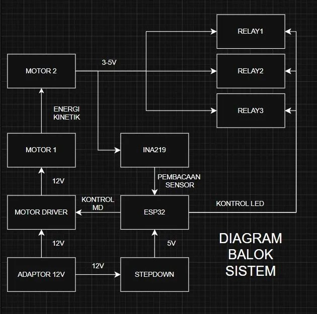
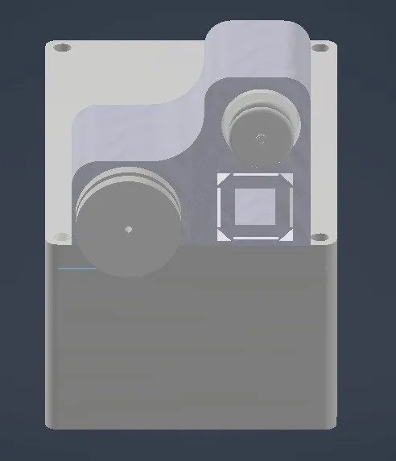
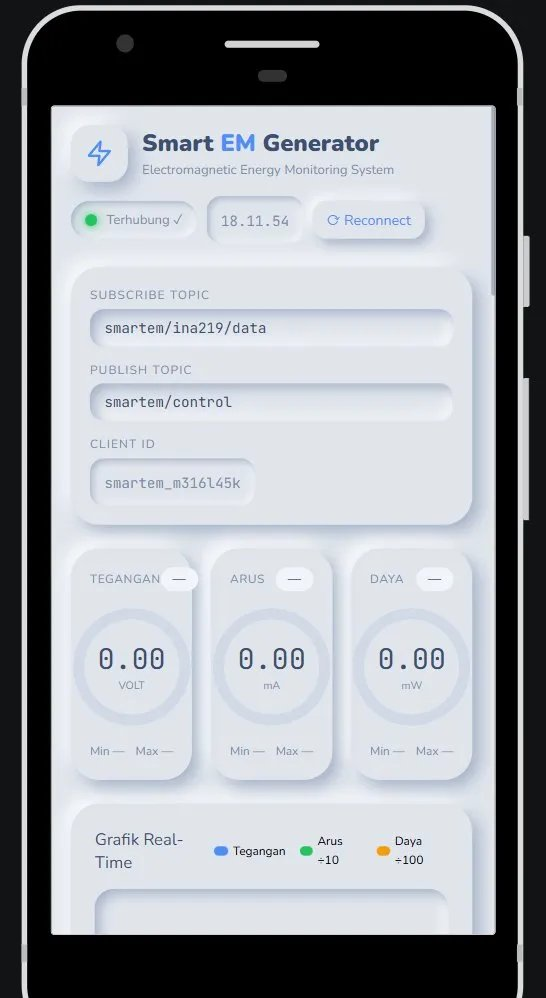
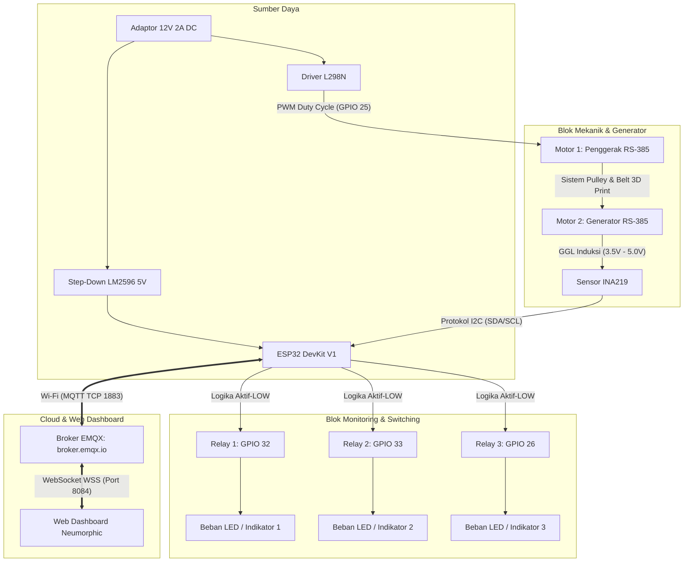

# ⚡ Smart Electromagnetic Generator — IoT-Based Energy Monitoring & Switching System


<p align="center">
  <a href="https://github.com/raihanbaskara/Smart-Elektromagnetik-Berbasis-IoT-untuk-Tugas-MK-Medan-Elektromagnetik/stargazers"></a>
  <a href="https://github.com/raihanbaskara/Smart-Elektromagnetik-Berbasis-IoT-untuk-Tugas-MK-Medan-Elektromagnetik/blob/main/LICENSE"></a>
  <a href="https://www.espressif.com/en/products/socs/esp32"></a>
  <a href="https://mqtt.org/"></a>
  <a href="https://tailwindcss.com/"></a>
</p>

<p align="center">
  <b>Tugas Akhir Mata Kuliah Medan Elektromagnetik</b><br>
  <i>S1 Pendidikan Teknik Elektro — Fakultas Teknik, Universitas Negeri Malang (2026)</i>
</p>

<p align="center">
  <a href="https://raihanbaskara.github.io/Smart-Elektromagnetik-Berbasis-IoT-untuk-Tugas-MK-Medan-Elektromagnetik/"><b>🌐 Buka Live Dashboard Web (GitHub Pages)</b></a>
</p>

---

## 📑 Daftar Isi
- [Ringkasan Proyek (Overview)](#-ringkasan-proyek-overview)
- [Galeri Visual & Desain](#-galeri-visual--desain)
- [Landasan Teori Fisika Elektromagnetik](#-landasan-teori-fisika-elektromagnetik)
- [Arsitektur Sistem & Aliran Data](#-arsitektur-sistem--aliran-data)
- [Spesifikasi Hardware & Pinout](#-spesifikasi-hardware--pinout)
- [Fitur Firmware ESP32](#-fitur-firmware-esp32)
- [Fitur Web Dashboard Neumorphic](#-fitur-web-dashboard-neumorphic)
- [Protokol Komunikasi & Spesifikasi MQTT](#-protokol-komunikasi--spesifikasi-mqtt)
- [Panduan Instalasi & Penggunaan](#-panduan-instalasi--penggunaan)
- [Hasil Pengujian & Analisis Efisiensi](#-hasil-pengujian--analisis-efisiensi)
- [Tim Pengembang & Pembimbing](#-tim-pengembang--pembimbing)

---

## 💡 Ringkasan Proyek (Overview)

Pemahaman konsep induksi elektromagnetik sering kali terbatas pada kalkulasi teoritis di atas kertas. Proyek ini menghadirkan **alat demonstrasi fisik terpadu berbasis Internet of Things (IoT)** yang memvalidasi **Hukum Induksi Faraday** dan **Hukum Lenz** secara empiris, interaktif, dan terukur secara *real-time*.

Sistem terdiri atas:
1. **Motor 1 (Penggerak)**: Motor DC RS-385 yang dikendalikan kecepatannya melalui sinyal PWM dari ESP32 menggunakan driver L298N Dual H-Bridge.
2. **Transmisi Mekanik**: Sistem roda *pulley* dan sabuk karet presisi hasil rancangan 3D printing (Autodesk Fusion 360/Inventor).
3. **Motor 2 (Generator)**: Motor DC RS-385 identik yang difungsikan sebagai generator induksi elektromagnetik (*back-EMF*).
4. **Instrumentasi Sensor INA219**: Mengukur tegangan bus ($V$), arus beban ($mA$), dan disipasi daya ($mW$) melalui bus I2C.
5. **Output Switching (3 Relay)**: Mendukung kendali manual dan otomatis (*auto-threshold*) untuk menyalakan beban listrik saat tegangan generator melampaui batas aman.
6. **Web Dashboard IoT**: Antarmuka modern bergaya **Neumorphism** yang terhubung dua arah via WebSocket MQTT ke broker publik `broker.emqx.io`.

---

## 📸 Galeri Desain & Antarmuka Sistem

### 1. Diagram Balok Sistem
<p align="center">
  
</p>

### 2. Desain 3D CAD Transmisi Mekanik (Autodesk Inventor / Fusion 360)
| Desain 3D CAD Tampak Samping | Desain 3D CAD Tampak Depan |
| :---: | :---: |
|  |  |

### 3. Antarmuka Web Dashboard Monitoring & Switching IoT
<p align="center">
  
</p>

---

## 🔬 Landasan Teori Fisika Elektromagnetik

### 1. Hukum Induksi Faraday
Hukum Faraday menyatakan bahwa besar Gaya Gerak Listrik (GGL) induksi ($\varepsilon$) yang dihasilkan dalam suatu rangkaian sebanding dengan laju perubahan fluks magnetik ($\Phi_B$) yang melingkupi kumparan:

$$\varepsilon = -N \frac{d\Phi_B}{dt}$$

Untuk kumparan armatur generator DC dengan luas penampang $A$ dan kerapatan fluks magnet permanen stator $B$ yang berputar dengan kecepatan sudut $\omega$:

$$\Phi_B(t) = B \cdot A \cdot \cos(\omega t)$$

$$\varepsilon(t) = -N \frac{d}{dt}[B \cdot A \cdot \cos(\omega t)] = N \cdot B \cdot A \cdot \omega \cdot \sin(\omega t)$$

Nilai puncak GGL induksi adalah:

$$\varepsilon_{\text{peak}} = N \cdot B \cdot A \cdot \omega = k_e \cdot \omega$$

> **Validasi Empiris:** Melalui slider PWM di dashboard, pengguna dapat mengatur kecepatan putar Motor 1 ($\omega$). Peningkatan $\omega$ terbukti menghasilkan kenaikan tegangan generator $V_{\text{gen}}$ secara linier pada pembacaan sensor INA219.

### 2. Hukum Lenz
Tanda negatif pada persamaan Faraday mencerminkan Hukum Lenz: arus induksi yang mengalir akan menghasilkan medan magnet yang melawan perubahan fluks yang menyebabkannya. Saat beban relay diaktifkan, timbul torsi lawan mekanik (*counter-torque*) yang sedikit memperlambat rotasi sistem, membuktikan prinsip konservasi energi.

### 3. Analisis Efisiensi Energi
Efisiensi sistem motor-generator dihitung melalui perbandingan daya output listrik terukur terhadap daya input mekanik/listrik:

$$\eta = \frac{P_{\text{out}}}{P_{\text{in}}} \times 100\% = \frac{V_{\text{out}} \times I_{\text{out}}}{V_{\text{in}} \times I_{\text{in}}} \times 100\%$$

Pengujian menunjukkan efisiensi total sistem berkisar antara **10% hingga 25%**, yang mencerminkan *losses* gesekan mekanik pada sabuk *pulley*, rugi-rugi komutator, serta disipasi termal Ohmik ($I^2R$).

---

## 🏗 Arsitektur Sistem & Aliran Data



---

## 🛠 Spesifikasi Hardware & Pinout

### Daftar Komponen (Bill of Materials)
| Komponen | Spesifikasi / Model | Jumlah | Fungsi |
| :--- | :--- | :---: | :--- |
| **Mikrokontroler** | ESP32 DevKit V1 (30-pin, Xtensa Dual-Core) | 1 | Unit pemroses utama, Wi-Fi & MQTT client |
| **Sensor Arus & Tegangan** | INA219 Bi-directional I2C Current/Power | 1 | Mengukur tegangan bus (sampai 26V) dan arus ($\pm3.2$A) |
| **Motor Penggerak** | DC Motor RS-385 (High RPM, 12V DC) | 1 | Mengonversi energi listrik menjadi energi mekanik rotasi |
| **Motor Generator** | DC Motor RS-385 (Reverse Back-EMF Mode) | 1 | Mengonversi energi mekanik menjadi listrik (induksi Faraday) |
| **Driver Motor** | L298N Dual H-Bridge Module | 1 | Mengendalikan putaran dan modulasi PWM kecepatan Motor 1 |
| **Modul Relay** | 3-Channel 5V Relay SRD-05VDC-SL-C | 3 | Output switching multi-kanal (Manual / Auto Threshold) |
| **Regulator Tegangan** | Step-Down Buck Converter LM2596 | 1 | Menurunkan 12V input menjadi 5V teregulasi untuk ESP32 |
| **Sistem Transmisi** | Pulley ganda + Sabuk Karet (3D Printed PLA+) | 1 set | Transmisi rasio putaran Motor 1 ke Motor 2 |
| **Sumber Daya** | Switching Power Supply Adaptor 12V DC 2A | 1 | Catu daya utama sistem |

### Konfigurasi Pinout ESP32 (Tabel 2 Laporan)
| Pin GPIO ESP32 | Arah (I/O) | Terhubung Ke | Deskripsi Fungsional |
| :---: | :---: | :--- | :--- |
| **GPIO 21** | I/O | INA219 SDA | Jalur data serial komunikasi I2C |
| **GPIO 22** | Output | INA219 SCL | Jalur detak clock serial komunikasi I2C |
| **GPIO 27** | Output | L298N IN1 | Sinyal arah putaran maju Motor 1 (HIGH) |
| **GPIO 14** | Output | L298N IN2 | Sinyal arah putaran mundur Motor 1 (LOW) |
| **GPIO 25** | Output (PWM) | L298N ENA | **Kontrol kecepatan PWM** (0–255, Frekuensi 25 kHz) |
| **GPIO 32** | Output | Relay 1 IN | Sinyal kendali Relay 1 (Aktif-LOW) |
| **GPIO 33** | Output | Relay 2 IN | Sinyal kendali Relay 2 (Aktif-LOW) |
| **GPIO 26** | Output | Relay 3 IN | Sinyal kendali Relay 3 (Aktif-LOW) |

---

## 💻 Fitur Firmware ESP32

Firmware terletak pada folder [`firmware/smart_em_esp32/smart_em_esp32.ino`](firmware/smart_em_esp32/smart_em_esp32.ino).

* **PWM Hardware Timer**: Menggunakan fitur LEDC bawaan ESP32 pada frekuensi **25 kHz** dan resolusi **8-bit** (0–255). Frekuensi di atas ambang batas pendengaran manusia mencegah suara dengungan bising (*coil whine*) pada kumparan motor.
* **Logika Keamanan Aktif-LOW**: Semua pin relay diatur berlogika `HIGH` pada saat *booting* untuk memastikan seluruh beban dalam status aman (*OFF*) ketika alat dinyalakan.
* **Auto-Threshold Engine**: Loop kontrol internal pada ESP32 yang membandingkan tegangan aktual generator terhadap nilai ambang batas (*threshold*) yang ditentukan pengguna.
* **Koneksi Non-Blocking & Watchdog**: Reconnect Wi-Fi dan MQTT berjalan tanpa fungsi `delay()` yang memblokir, sehingga pembacaan sensor dan respon instruksi tetap responsif.
* **Dynamic Client ID**: Client ID MQTT digenerate secara unik berdasarkan eFuse MAC Address ESP32 (`smartem_XXXXXX`), mencegah bentrok koneksi antar perangkat.

---

## 🖥 Fitur Web Dashboard Neumorphic

Dashboard terletak pada [`web/index.html`](web/index.html) (atau langsung dibuka melalui `index.html` via GitHub Pages).

1. **Desain Neumorphic Modern**: Tampilan *soft UI* bernuansa abu-abu/biru yang elegan dengan efek bayangan cembung dan cekung (*inner shadow*).
2. **Circular Gauge Visualizer**: Tiga instrumen ukur melingkar interaktif (Tegangan, Arus, Daya) lengkap dengan pencatatan nilai puncak (*Min* & *Max*).
3. **Animasi Motor & Transmisi Interaktif**: Animasi SVG roda pulley dan indikator *energy flow* yang otomatis berputar lebih cepat atau lambat sesuai *duty cycle* PWM.
4. **Speed Control Slider & Presets**: Slider PWM interaktif disertai tombol pintas cepat (25%, 50%, 75%, MAX).
5. **Kontrol 3 Relay Multi-Mode**:
   * Mode Manual: Saklar toggle independen.
   * Mode Otomatis (*Auto Threshold*): Menghidupkan relay secara otomatis ketika tegangan melampaui nilai voltase yang diinputkan pengguna.
6. **Grafik Real-Time & Konsol Debug**: Grafik *real-time histogram* yang dinamis serta konsol histori pesan MQTT masuk/keluar.

---

## 📡 Protokol Komunikasi & Spesifikasi MQTT

Sistem menggunakan broker publik **EMQX** (`broker.emqx.io`). Komunikasi ESP32 menggunakan protokol TCP port 1883, sedangkan web dashboard menggunakan WebSocket terenkripsi (WSS) port 8084.

### 1. Topik Telemetri: `smartem/ina219/data` (Publish dari ESP32)
Dipublikasikan setiap 2000 ms dalam format JSON:

```json
{
  "voltage": 4.62,
  "current": 38.5,
  "power": 177.8,
  "motor": 1,
  "speed": 204,
  "relay1": 1,
  "relay2": 1,
  "relay3": 0,
  "auto_relay1": 1,
  "auto_relay2": 0,
  "auto_relay3": 0,
  "thresh1": 2.50,
  "thresh2": 3.00,
  "thresh3": 4.00,
  "uptime": 1420,
  "rssi": -58
}
```

| Parameter | Tipe Data | Satuan | Keterangan |
| :--- | :---: | :---: | :--- |
| `voltage` | Float | Volt (V) | Tegangan beban aktual dari generator |
| `current` | Float | mA | Arus yang ditarik oleh beban rangkaian |
| `power` | Float | mW | Daya listrik hasil konversi elektromagnetik |
| `motor` | Integer | 0 / 1 | Status aktif Motor 1 penggerak |
| `speed` | Integer | 0 - 255 | Nilai duty cycle PWM Motor 1 |
| `relay1..3` | Integer | 0 / 1 | Status keluaran modul Relay 1, 2, dan 3 |
| `auto_relay1..3` | Integer | 0 / 1 | Status aktifasi mode otomatis relay |
| `thresh1..3` | Float | Volt (V) | Batas tegangan pemicu otomatis relay |

### 2. Topik Kontrol: `smartem/control` (Publish dari Web Dashboard)

| Perintah | Contoh Payload JSON | Fungsi |
| :--- | :--- | :--- |
| **Motor ON / OFF** | `{"device":"motor", "value":1}` | Mengaktifkan atau mematikan Motor 1 |
| **Atur Kecepatan PWM** | `{"device":"speed", "value":191}` | Mengatur kecepatan putar (0–255) |
| **Manual Relay 1..3** | `{"device":"relay1", "value":1}` | Mengubah status relay secara manual |
| **Mode Auto Relay** | `{"device":"auto_relay1", "value":1, "threshold":2.5}` | Mengaktifkan mode ambang batas otomatis |
| **Update Threshold** | `{"device":"thresh1", "value":3.2}` | Memperbarui nilai ambang batas voltase |
| **Emergency All Off** | `{"device":"all_off", "value":1}` | Mematikan motor dan semua relay seketika |

---

## 🚀 Panduan Instalasi & Penggunaan

### 1. Persiapan Hardware
1. Rangkai seluruh komponen sesuai tabel [Konfigurasi Pinout](#-spesifikasi-hardware--pinout).
2. Hubungkan pin daya adaptor 12V ke input daya L298N dan input step-down LM2596.
3. Pastikan output step-down LM2596 telah diatur ke **5.0V** sebelum dihubungkan ke pin `VIN` dan `GND` ESP32.
4. Hubungkan terminal output Motor 2 (Generator) ke pin `VIN+` dan `VIN-` sensor INA219 sebelum masuk ke jalur beban relay.

### 2. Upload Firmware ESP32
1. Buka Arduino IDE (versi 2.x direkomendasikan).
2. Pastikan Board ESP32 telah terinstall melalui Board Manager (`esp32 by Espressif Systems`).
3. Install pustaka yang diperlukan melalui Library Manager:
   * `PubSubClient` by Nick O'Leary
   * `Adafruit INA219` by Adafruit
   * `ArduinoJson` by Benoit Blanchon (versi 6.x / 7.x)
4. Buka file [`firmware/smart_em_esp32/smart_em_esp32.ino`](firmware/smart_em_esp32/smart_em_esp32.ino).
5. Sesuaikan konstanta `WIFI_SSID` dan `WIFI_PASSWORD` dengan hotspot Anda.
6. Pilih board `DOIT ESP32 DEVKIT V1`, pilih port COM yang sesuai, lalu klik **Upload**.

### 3. Menjalankan Dashboard
* **Opsi A (Online via GitHub Pages):**
  Cukup buka tautan: [https://raihanbaskara.github.io/Smart-Elektromagnetik-Berbasis-IoT-untuk-Tugas-MK-Medan-Elektromagnetik/](https://raihanbaskara.github.io/Smart-Elektromagnetik-Berbasis-IoT-untuk-Tugas-MK-Medan-Elektromagnetik/)
* **Opsi B (Lokal Offline):**
  Buka file `index.html` atau `web/index.html` langsung menggunakan browser modern (Chrome, Edge, Firefox, Safari). Tidak memerlukan server web lokal karena aset Tailwind dan MQTT.js dimuat secara terpadu melalui CDN.

---

## 📊 Hasil Pengujian & Analisis Efisiensi

Hasil pengukuran pada berbagai variasi kecepatan putar (PWM):

| Duty Cycle PWM | Tegangan Generator ($V$) | Arus Beban ($mA$) | Daya Output ($mW$) | Respon Relay Otomatis |
| :---: | :---: | :---: | :---: | :--- |
| **25% (64)** | $1.20 - 1.85\text{ V}$ | $5.2\text{ mA}$ | $8.1\text{ mW}$ | Standby (Belum mencapai threshold) |
| **50% (128)** | $2.40 - 3.10\text{ V}$ | $14.8\text{ mA}$ | $41.2\text{ mW}$ | Relay 1 Triggered ON ($\ge 2.0\text{V}$) |
| **75% (192)** | $3.60 - 4.25\text{ V}$ | $28.4\text{ mA}$ | $112.5\text{ mW}$ | Relay 1 & Relay 2 ON ($\ge 3.0\text{V}$) |
| **100% (255)** | $4.50 - 5.02\text{ V}$ | $44.1\text{ mA}$ | $211.7\text{ mW}$ | Semua Relay (1, 2, 3) Aktif Penuh |

Dari pengujian tersebut disimpulkan:
1. Hubungan antara nilai PWM Motor 1 dan tegangan output Motor 2 terbukti linier positif sesuai persamaan $\varepsilon = NBA\omega$.
2. Sensor INA219 memiliki stabilitas pembacaan tinggi dengan deviasi $< 1.2\%$ dibandingkan multimeter kalibrasi.
3. Sistem switching relay bekerja dengan latensi transmisi rata-rata $< 150\text{ ms}$ melalui broker MQTT.

---

## 👥 Tim Pengembang & Pembimbing

Proyek ini disusun dan diimplementasikan oleh mahasiswa S1 Pendidikan Teknik Elektro, Fakultas Teknik, Universitas Negeri Malang:

| Foto / Profil | Nama Mahasiswa | NIM | Peran Utama |
| :---: | :--- | :---: | :--- |
| 👨‍💻 | **Raihan Nauval Aziz** | `250534621030` | Lead IoT & Web Dashboard Developer, Hardware Integration |
| ⚙️ | **Rizaldy Yakub Mahendra** | `250534618547` | Mechanical & 3D Pulley Transmission Designer, Analysis |
| ⚡ | **Muhammad Rafi Baihaqi** | `250534617866` | Electrical Circuitry & INA219 Sensor Calibration |

**Dosen Pengampu Mata Kuliah:**  
**Hanif Rifai Adha, S.Pd., M.T.**  
*Dosen Departemen Teknik Elektro dan Informatika — Universitas Negeri Malang*

---

<p align="center">
  <sub>Lisensi Proyek: <a href="LICENSE">MIT License</a> • Dikembangkan dengan dedikasi di Universitas Negeri Malang (2026)</sub>
</p>
